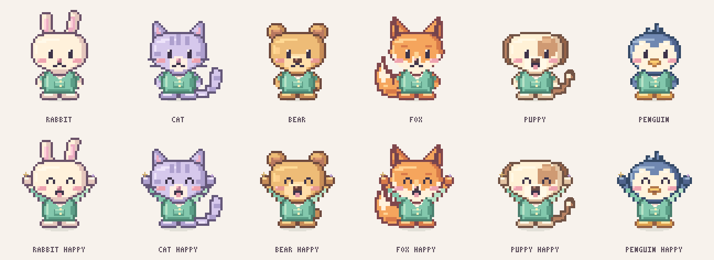

# v0.4.0 캐릭터 리디자인

작성일: 2026-10-19. 여섯 친구의 외형을 더 분명한 도트 형태로 바꾸고, 캐릭터 그림을 담는 카드와 미리보기의 잘림 원인을 수정했습니다.



## 그림의 기준

동물 몸체는 **48×48 스프라이트 그리드**를 사용합니다. 기존 의상과 소품이 사용하는 **96×96 장착 좌표** 안에서 스프라이트 한 도트를 2×2 논리 픽셀로 그립니다. 배경·모자·소품까지 모두 48×48로 축소하는 방식은 아닙니다. 기존 장착 자리를 유지하면서 동물의 머리·귀·팔·발·꼬리와 눈·코·입을 더 굵은 도트로 바꿨습니다.

`dist/avatar.js`의 `spriteForm()`은 행마다 정한 시작·끝 좌표를 따라 블록을 채웁니다. 위아래·좌우의 이웃이 없는 부분을 외곽선으로 정하고, 몸체의 오른쪽과 아래쪽에는 단순한 그림자를 넣습니다. 타원을 여러 겹 겹쳤던 머리 대신 계단 모양의 윤곽과 넓은 색 면을 사용합니다. 의상 밑단도 굵은 도트 형태에 맞게 조정했습니다.

원본은 코드로 그립니다. 외부 이미지 다운로드, 폰트 기반 캐릭터나 생성 이미지 파일을 게임 렌더링에 사용하지 않습니다. 게임의 캔버스에서는 `imageSmoothingEnabled = false`, 표시 CSS에서는 `image-rendering:pixelated`를 사용합니다. 최종 표시 크기가 원본의 정수 배수가 아닐 때 각 도트의 화면상 크기는 브라우저와 기기의 픽셀 비율에 따라 달라질 수 있습니다.

## 여섯 친구의 구분

| 친구 | 색과 실루엣 | 얼굴의 특징 |
| --- | --- | --- |
| 구름토끼 | 크림색 몸과 서로 조금 다른 길쭉한 귀 | 분홍 귀 안쪽, 큰 눈과 분홍 볼 |
| 달빛고양이 | 연보라색 몸, 뾰족한 귀와 올라간 꼬리 | 이마 줄무늬, 수염과 밝은 주둥이 |
| 꿀잠곰 | 꿀빛 갈색 몸, 넓은 둥근 귀와 짧은 발 | 넓은 크림색 주둥이와 큰 코 |
| 단풍여우 | 선명한 주황색 몸, 짙은 귀 끝과 풍성한 꼬리 | 흰 볼의 계단 모양과 흰 꼬리 끝 |
| 밀크강아지 | 우유색 몸, 코코아색으로 축 처진 귀 | 한쪽 눈 주변 무늬, 밝은 주둥이와 작은 혀 |
| 꼬마펭귄 | 짙은 남색 외곽과 파란 몸, 머리 위 깃 | 크림색 얼굴, 노란 부리와 발 |

몸통의 의상 영역은 모든 친구가 공유합니다. 친구를 바꾸는 재미는 귀·얼굴 무늬·꼬리와 색에서 나오며, 가지고 있던 옷과 소품은 계속 사용할 수 있습니다.

## 장착 좌표와 API 호환성

`AVATAR_SIZE`는 96을 유지합니다. 출력 배율 `scale`은 정수 1~6이며 캔버스 크기는 `96 × scale`입니다. 앱은 기존처럼 `scale:2`를 사용합니다.

```js
drawAvatar(canvas, {
  character: 'rabbit',
  outfit: 'mint',
  hat: 'none',
  accessory: 'none',
  pose: 'idle',
  background: 'garden',
  scale: 2,
});

drawItem(canvas, {
  slot: 'hat',
  value: 'crown',
  equipped: currentEquipment,
  scale: 2,
});
```

`drawAvatar()`는 정규화한 옵션을 반환하고, 알 수 없는 장착 값은 해당 슬롯의 기본값으로 되돌립니다. `drawItem()`은 현재 장착 정보에 상품 하나를 적용해 같은 렌더러로 보여줍니다. 별도의 상품용 캐릭터 그림을 사용하지 않아 상점과 실제 착용의 외형을 같은 코드로 관리합니다.

눈은 x38·56 주변, 옷깃은 y58~68, 의상은 y57~79, 바닥은 y84 주변의 기존 기준을 유지합니다. 안경·모자·목도리·가방·지팡이 등이 사용하는 장착 자리도 유지합니다. 렌더 순서는 배경과 그림자, 날개·꼬리·뒤 소품, 귀·몸·팔·옷, 얼굴, 모자, 앞 소품입니다.

### 인사 표정

`pose:'happy'`에서는 눈이 웃는 모양으로 바뀌고 두 손을 듭니다. 캐릭터 전체를 논리 좌표 2px만큼 위로 옮기며 주변에 반짝임을 표시합니다. 토끼의 귀 모양도 조금 달라집니다. 홈의 인사 동작은 기존 이벤트를 사용하고, 캐릭터 렌더러 자체에 반복 타이머를 추가하지 않습니다.

## 무료 토끼와 기존 구매 정보

구름토끼만 기본 무료입니다. 다른 다섯 친구는 코인으로 구매하는 정책과 가격을 유지합니다. 새 외형 때문에 친구를 다시 구매할 필요가 없습니다.

| 친구 | 저장 값 | 가격 |
| --- | --- | ---: |
| 구름토끼 | `rabbit` | 기본 제공 |
| 달빛고양이 | `cat` | 300코인 |
| 꿀잠곰 | `bear` | 450코인 |
| 밀크강아지 | `puppy` | 500코인 |
| 단풍여우 | `fox` | 650코인 |
| 꼬마펭귄 | `penguin` | 800코인 |

`character-*` 상품 ID, 장착 값, 소유 아이템, 코인과 게임 기록을 유지합니다. 게임 저장 키는 `haru-five-playtest-v1`, 상태 버전은 `version:1`, 기존 경제 규칙은 `economyVersion:2`입니다. v0.3에서 도입한 과거 무료 캐릭터 이전 규칙은 남아 있지만, v0.4.0에서 이미 구매한 친구를 다시 회수하거나 경제 버전을 올리지는 않습니다.

리디자인은 기록과 문제 진행 상태의 초기화를 요구하지 않습니다. 브라우저 데이터 삭제나 별도의 새 게임 동작으로 기록을 초기화하는 기존 기능과 구분합니다.

## 그림 잘림과 비율 수정

| 위치 | 기존 원인 | v0.4.0 조정 |
| --- | --- | --- |
| 캐릭터 선택 카드 | 가로 114%의 캔버스를 직사각형 프레임 안에서 중앙 정렬해 귀와 발을 자름 | 프레임을 정사각형으로 맞추고 캔버스 가로를 100%로 변경 |
| 헤더의 작은 아바타 | 31~38px 컨테이너에 캔버스는 40px 고정, 위쪽 패딩만 있음 | 컨테이너에 맞는 가로 100%와 자동 높이, 균등 1px 패딩 적용 |
| 모바일 프로필·피팅룸 | 캔버스의 `max-width:none`이 좁은 칸 너비 제한을 해제 | `max-width:100%`로 칸에 맞춰 축소 |
| 홈 상품 미리보기 | 프레임의 가로·세로 크기가 다른데 고정 캔버스 크기를 사용 | 부모 영역에 맞춘 크기와 `object-fit:contain` 적용 |
| 상점 상품 그림 | 고정 높이와 위쪽 7px 여백이 그림을 프레임 밖으로 밀어냄 | 최대 높이 100%, `object-fit:contain`, 불필요한 위쪽 여백 제거 |
| 컬렉션·캐릭터 구매창 | 가로가 좁아져도 높이는 고정될 수 있음 | 높이 자동과 정사각형 비율 적용 |

기존 선택 카드의 모바일 `aspect-ratio:1.3`과 114% 확대를 계산하면 논리 좌표에서 위아래 약 15.6px씩 잘리는 조건이었습니다. 이 수치는 CSS 크기 관계의 계산이며 실제 기기의 픽셀 위치를 측정한 값은 아닙니다. 카드 열 수, 상품 이름, 가격과 버튼 동작은 유지합니다.

## PNG 검수 실행

프로젝트 루트에서 Node.js로 실행합니다. 별도 브라우저, 서버나 외부 패키지 설치는 필요하지 않습니다.

```sh
node scripts/avatar-pixel-qa.mjs --out /tmp/haru-pixel-qa
```

전체 캐릭터·의상·모자·소품·포즈 조합의 경계와 동일 출력까지 진단하려면 다음 명령을 사용합니다.

```sh
node scripts/avatar-pixel-qa.mjs --out /tmp/haru-pixel-qa --full
```

도구는 실제 `dist/avatar.js`의 `drawAvatar()`와 `drawItem()`을 불러옵니다. 캔버스의 축에 평행한 사각형, 배율·이동 변환과 source-over 투명도 합성을 로컬 래스터 어댑터로 재현하고 PNG를 기록합니다. 캐릭터 그림을 별도로 복제하거나 검수용 그림으로 대체하지 않습니다.

| 출력 | 용도 |
| --- | --- |
| `friends.png` | 여섯 친구의 기본·인사 포즈 비교 |
| `friend-*.png` | 각 친구의 기본 원본 |
| `small-samples.png` | 32px·40px 최근접 축소 예시 |
| `outfit.png` | 각 친구와 의상 옵션 |
| `hat.png` | 각 친구와 모자 옵션 |
| `accessory.png` | 각 친구와 소품 옵션 |
| `background.png` | 배경 옵션 비교 |
| `report.json` | 크기, 그리기 경계, 잘림, 픽셀 해시와 전체 조합 진단 |

`--source /absolute/avatar.js`로 비교할 렌더러 파일을 지정하거나 `--prefix before-`처럼 파일명 접두사를 붙일 수 있습니다. 이미지 시트를 먼저 비교하고 `report.json`의 항목을 함께 확인합니다. 일반 실행의 친구별 경계 기록과, `--full`의 모든 장착 조합 기록은 범위가 다릅니다.

전체 실행의 `clippedOrEmpty`는 캔버스 밖으로 나가는 그리기 명령 또는 빈 출력을 담습니다. `identicalCombinationPairs`는 서로 다른 장착 조합이 같은 최종 픽셀을 만드는 경우입니다. 어느 배열이든 비어 있지 않으면 리포트와 시트를 저장한 뒤 명령의 종료 코드를 1로 반환합니다. 옵션 목록에는 컬렉션 시착용 자산도 포함되므로 조합 수를 코인 상점에서 구매 가능한 상품 수로 해석하지 않습니다.

시각 검수에서는 귀 끝과 발, 얼굴과 안경의 위치, 머리와 모자의 연결, 손과 소품의 위치, 인사할 때 손이 얼굴 뒤로 가려지는지, 어두운 배경에서 외곽이 구분되는지를 확인합니다. 서로 다른 픽셀 해시만으로 그림이 보기 좋은지나 아이템이 충분히 구별되는지를 판단하지 않습니다.

### 최종 실행 결과

| 확인 항목 | v0.4.0 상태 |
| --- | --- |
| 전체 자동 테스트 `npm test` | 8개 테스트 파일 통과, 컨트롤러의 99개 화면 상태 검증 포함 |
| JavaScript 문법 `npm run check` | 통과 |
| 전체 조합 PNG 진단 `--full` | 20,592개 장착·포즈 조합, 빈 출력·캔버스 밖 그리기 0건, 완전히 같은 조합 출력 0건 |
| 생성한 PNG 시각 확인 | 기본·인사, 작은 크기, 모자·소품·의상 시트를 육안 검토했으며 필수 수정이 필요한 잔여 결함을 찾지 못함 |
| 실제 Safari·Chrome 화면·터치 검수 | 미수행 |

위 결과는 이번 v0.4.0 소스의 최종 테스트·진단 실행과 생성 이미지 확인에 해당합니다. 실제 브라우저의 화면 검수나 모든 장착 조합의 미적 완성도를 보장하는 결과는 아닙니다. 자동 조합 진단과 대표 시트의 시각 검토를 구분합니다.

## 실제 브라우저 검수와의 차이

이 PNG 도구는 배포 코드가 내보낸 사각형을 확인하기 위한 도구입니다. 실제 브라우저의 CSS 레이아웃 엔진, 글꼴, 화면 배율, 이미지 샘플링, 터치 영역, 접근성 동작을 검증하지 않습니다. 32px·40px 축소본도 최근접 방식의 참고 이미지이며 Safari나 Chrome의 최종 스크린샷이 아닙니다.

현재 개발 환경에는 Sites가 지원하는 브라우저 제어 기능이 없어 실제 브라우저 검수는 수행하지 않았습니다. 출시 전 실제 모바일에서 헤더 아바타, 캐릭터 여섯 장의 카드, 좁은 피팅룸, 상품 미리보기, 인사 포즈와 구매 후 재접속을 확인해야 합니다. [v0.3.2 화면 점검 이력](ui-review.md)은 해당 버전의 기능·레이아웃 검증 기록으로 유지하며, 그 결과를 이번 캐릭터 렌더링과 실제 기기 검수의 대체 근거로 사용하지 않습니다.
